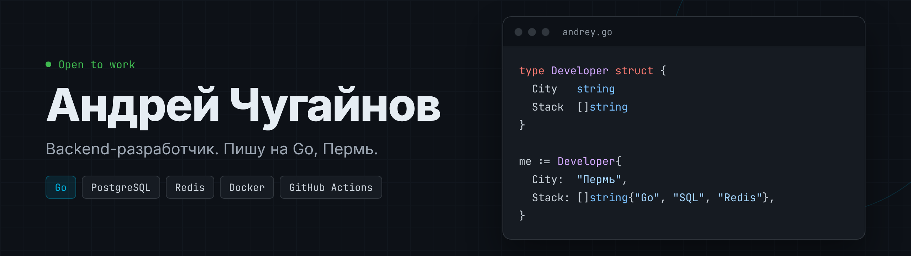

Backend-разработчик на Go, Пермь. REST API, PostgreSQL и SQLite, Redis, Docker, CI в GitHub Actions.

Связь: [Telegram @chugastok](https://t.me/chugastok) · sprunk59@yandex.ru

## Стек

## Проекты

| Проект | Что это | Стек |
|---|---|---|
| [vetKlinika](https://github.com/Chugerbuller/vetKlinika) | Учёт клиентов, питомцев и приёмов для ветклиники | Go, SQLite, REST API |
| [caching-proxy](https://github.com/Chugerbuller/caching-proxy) | Прокси-сервер, кэширующий ответы внешнего API в Redis | Go, Gin, Redis, Docker Compose |
| [task-scheduler](https://github.com/Chugerbuller/task-scheduler) | Планировщик задач с повторениями, JWT-авторизацией и веб-интерфейсом | Go, SQLite, JWT, Docker |
| [CloudStorage](https://github.com/Chugerbuller/CloudStorage) | Облачное хранилище файлов с desktop-клиентом | C#, ASP.NET Core, PostgreSQL |
| [BackupSys](https://github.com/Chugerbuller/BackupSys) | Утилита параллельного резервного копирования | C#, .NET 9, xUnit |

## Обучение

Яндекс Практикум, «Go-разработчик с нуля» (2025–2026, 379 часов).
